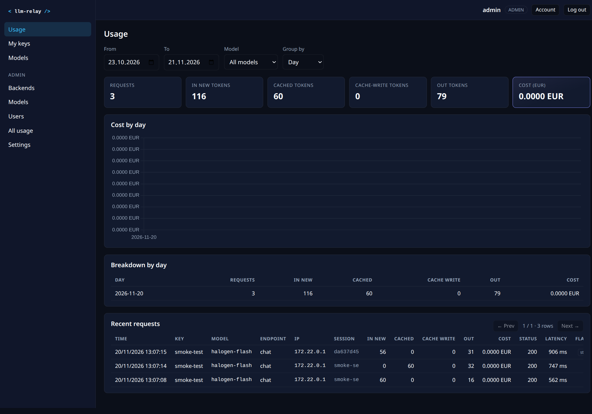

# llm-relay

OpenAI-compatible relay for local LLMs: per-key token metering, pricing and a cost dashboard (Go + SQLite, Docker).

Front a local LLM (any OpenAI-compatible server — llama.cpp, halogen, Ollama, …) and share it
with friends: each user logs into the dashboard, creates one API key per app, and every request
is metered (input / output / cache-read / cache-write tokens, per session, per client IP) and
priced. Admins manage backends, the model catalog and prices; users see their own usage and cost.
Several relays can also **federate** — a hub and its spokes pool model capacity across machines.

- **Relay API:** `:8080` (`/v1/*`, `sk-` keys) — what friends' apps point at
- **Dashboard + admin API:** `:8081` (JWT, embedded SPA) — the port to front with a reverse proxy
- **Repo:** https://github.com/Gizmozator/llm-relay

## Dashboard

After login every user lands on the **Dashboard**: a live server-wide view of
the last hour — a per-minute traffic graph (requests / tokens), a per-model
**utilization graph** (busy time per minute; the axis scales to the model's
concurrency limit, so 4 parallel slots read as 0–400 %), how many streams are
decoding right now per model, and which catalog models are online (backend
health is re-probed at most once a minute). Cost stays off this view — it is
per-user and lives on the **Usage** pages. Admins additionally see **Active
connections** — who is on which model right now (user, key, endpoint, session,
IP, running time), **grouped one row per session**: parallel requests of the
same session show as `×N`, and finished requests stay listed for a minute as
"done 4s ago" — and a per-user **Last used** list, both as relative times
("1 min ago") refreshed with the same 5 s poll. The **Backends** page shows the
same live health verdict as its Status badge (re-probed at most once a minute,
the page re-polls every 10 s); the **Last probe** column keeps the result of
the last manual Probe.

The **Agent API** page explains how to point an AI agent at the relay: hand
your agent the public guide link (`{relay}/v1/agent-guide`), or wire the MCP
endpoint (`{relay}/mcp`, one `check_utilization` tool) so it can check
whether a model is `free` / `busy` / `draining` / `offline` before taking
delegated work. Agents authenticate with the same `sk-` keys from **My keys**.




Each backend has a **Draining** switch for graceful shutdown: flip it on
before powering the engine's server off and the relay refuses *new* sessions
on that backend (`503` + `Retry-After`), while conversations that are
currently running (active within 15 min) finish their remaining turns.
Agent endpoints report it as `status: "draining"`.

## Model groups

A **model group** is one public name (e.g. `qwen3-coder`) backed by several
model rows on different machines: users request the group name, the relay
picks a member per request. Admins manage groups on the **Models** page
(**Groups** panel): create a group, add members with weights, enable it.
Groups are born **disabled**, and a memberless group cannot be enabled. A
blank member weight seeds from that machine's last benchmark speed, so faster
machines take proportionally more sessions.

**Routing** is a weighted rendezvous hash of the session id: one conversation
is pinned to one member so each engine's prompt cache stays warm. Send a
stable `X-Session-Id` header to keep that affinity; different sessions spread
across members roughly proportional to their weights. Only *hard exclusions*
reroute — a disabled, draining, or unhealthy member is skipped. A **saturated
member does not reroute**: queueing at the engine beats cold caches for
everyone. If a member dies before its first byte, the request retries on the
next-ranked member; a stream that already started is never retried.

**Visibility**: adding a model to a group makes it `internal` — hidden from
`/v1/models` and the dashboard; the group name is what users request. Members
stay directly requestable by name (pin/debug), and an admin can re-expose one.
Users see a group badge on the **Models** page, one pooled row per group on
the live dashboard, and usage billed under the requested group name.

The agent endpoints (`GET /v1/utilization`, MCP `check_utilization`) mirror
this split: non-admin keys get the advertised catalog — group rows (negative
`id`) plus public standalones; admin keys get the physical per-machine rows
(`docs/api-contract.md`).

## Federation

Two or more relays can pool their capacity: a **hub** accepts channels from
**spokes** — other relays that dial in with a server token and share selected
models. A spoke keeps running standalone; its opted-in models appear on the
hub as ordinary catalog rows (and are relayed onward to the other spokes), so
any user on any member can request them, with the same routing, affinity and
metering as local models. The spoke always dials out — the hub never needs to
reach into the spoke's network.

**Roles** are set on the admin **Federation** page: `standalone` (default, no
federation), `hub`, `spoke`. A spoke enters the hub URL + token there and sees
its live channel status; every user mints their own `fed-…` server token on
**My keys** and follows the **Connect server** guide (shown while the instance
is a hub). What to share is a per-model switch on the admin **Models** page
(`off` / `all` / `allowlist`) — nothing leaves the box until you opt a model
in. Quickstart: hub → *My keys → Server token* → spoke → *Admin → Federation →
spoke + hub URL + token* → spoke *Models* → set the models to share to `all`.

**Users see models, admins see the cluster**: a federated model behaves like
any other row (its health *is* the channel; groups may pool several peers'
copies), while the admin **Servers** page lists every peer with its online
state, version, shared models and the fairness ledger — served vs consumed
per user and per server. Usage through a federated model is metered to the
consuming user and credited to the serving account: fairness bookkeeping,
not billing.

**Security**: server tokens (`fed-…`) authenticate only the federation
channel, never `/v1/*` (and API keys never the channel); they are hashed,
shown once, rotatable, and disabling a peer drops its live channel at once.
Spoke-local usernames never leave the spoke — the hub stamps its own identity
onto forwarded traffic and is the attribution authority for the ledger.

## Supported upstream dialects

| Route | Dialect | Metered |
|---|---|---|
| `POST /v1/chat/completions` | OpenAI chat (streaming + tools) | yes |
| `POST /v1/completions` | OpenAI text | yes |
| `POST /v1/responses` | OpenAI Responses (Codex CLI) | yes |
| `POST /v1/messages` | Anthropic Messages (Claude Code) | yes |
| `POST /v1/messages/count_tokens` | Anthropic | pass-through |
| `POST /v1/embeddings` | OpenAI embeddings | yes |
| `GET /v1/models` | catalog listing | — |

Usage is taken from upstream `usage` reports (streaming included); a chars/4 heuristic is the
fallback and such rows are flagged `usage_estimated`. Sessions come from the `X-Session-Id`
header or a derived conversation hash. Streams carry an SSE comment line (`: keepalive`)
roughly every 20 s of upstream silence so edge proxies (Cloudflare's ~100 s idle limit)
don't cut long prefills; compliant SSE parsers ignore comments.

## Quickstart

```bash
cp .env.example .env      # set JWT_SECRET (+ optional bootstrap admin)
make docker-up            # build image + start: relay :8080, dashboard :8081
```

Open `http://localhost:8081`, log in, then: **Backends → add** the LLM server base URL
(e.g. `http://your-llm-host:8731`) → **Sync** → pick discovered models → set prices →
**My keys → create key** → point any OpenAI-compatible client at `http://localhost:8080/v1`
with the key as bearer token.

For self-hosted engines, the admin Models page has a **Benchmark** button per model:
it measures generation speed (TG — decode of a natural prose prompt) and prompt-
processing speed (PP — a ~10k-token randomized prompt, time to first token) against
the upstream. The **Calc prices** calculator prefills both speeds from the last run;
enter the machine's power draw for generation and prompt processing plus the
electricity price, and it derives cost-recovery prices (rounded up to 1 cent per 1M
tokens, editable before applying).

For local dev without Docker: `make web && make run`.

## Common tasks

| task | command |
|---|---|
| list all targets | `make` |
| build binary / web dashboard | `make build` / `make web` |
| full check (fmt + vet + tests) | `make ci` |
| run locally | `make run` (relay `:PORT`, dashboard `:ADMIN_PORT`) |
| build container | `make docker-build` |
| start / stop local stack | `make docker-up` / `make docker-down` |
| publish container image | `make docker-release VERSION=0.1.1` |
| federation e2e (manual, localhost 18xxx) | `scripts/e2e-federation.sh` |

## Configuration

Environment (or `.env`, see `.env.example`):

| var | default | meaning |
|---|---|---|
| `PORT` / `LISTEN_ADDR` | `8080` | relay API port (host mapping) |
| `ADMIN_PORT` / `ADMIN_ADDR` | `8081` | dashboard + `/api/*` port |
| `DB_PATH` | `/data/llm-relay.db` | SQLite file (parent dir auto-created) |
| `JWT_SECRET` | — **required** | dashboard JWT signing key (≥16 chars; `openssl rand -hex 32`) |
| `ADMIN_USERNAME` / `ADMIN_PASSWORD` | — | bootstrap admin, first run on empty DB only |
| `TRUST_PROXY_HEADERS` | `false` | trust `X-Forwarded-For` (set behind a reverse proxy) |
| `PUBLIC_RELAY_URL` / `PUBLIC_DASHBOARD_URL` | — | public URLs shown in the dashboard; relay is the **root** (no `/v1` — the dashboard appends `/v1` for the OpenAI base) |
| `TZ` | `Europe/Helsinki` | timezone |

## Deployment

`deploy/` ships a sample container-compose stack. Point it at your own registry and
data directory, set `JWT_SECRET` (+ optional bootstrap admin) in the stack `.env`,
and publish a new image version with `make docker-release VERSION=x.y.z`.

## Layout

```
llm-relay
├── cmd/llm-relay/         main: config, wiring, dual-port servers, embedded SPA
├── internal/config        env parsing
├── internal/db            SQLite open + embedded migrations
├── internal/auth          bcrypt, JWT, API key generation/hashing
├── internal/store         all SQL: CRUD + usage aggregation
├── internal/pricing       cost snapshots (integer micro-units)
├── internal/usage         buffered usage recorder
├── internal/proxy         dialect forwarder, SSE scanning, backend discovery
├── internal/api           dashboard JSON API (user + admin)
├── web/                   Vite + React + Chart.js dashboard (embedded via go:embed)
├── scripts/               manual tools: federation e2e (two relays + mock engines)
├── deploy/                sample container-compose stack
├── docs/
│   ├── api-contract.md    authoritative HTTP API contract
│   ├── screenshots/       dashboard screenshots (shown in README)
│   ├── workflows/         how we work: review, bug loop, feature loop, conventions
│   └── plans/             implementation plans (current + archived)
├── Dockerfile             node → go → scratch multi-stage
└── docker-compose.yml     local stack
```

## Documentation

Start at `AGENTS.md` for working rules, `docs/api-contract.md` for the HTTP surface,
`docs/workflows/README.md` for the runbooks, and `docs/plans/` for what is being built now.
