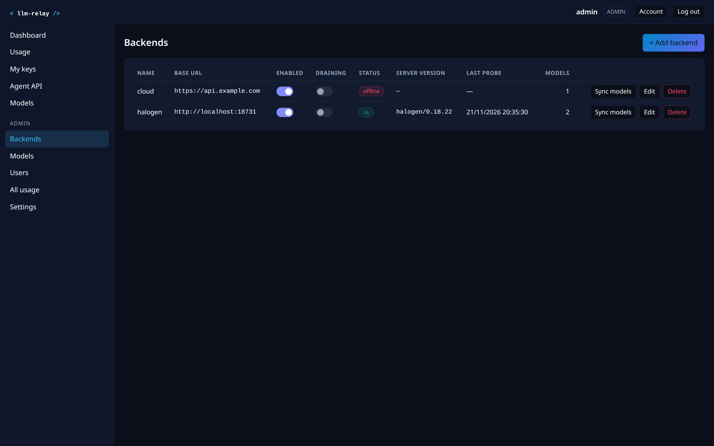
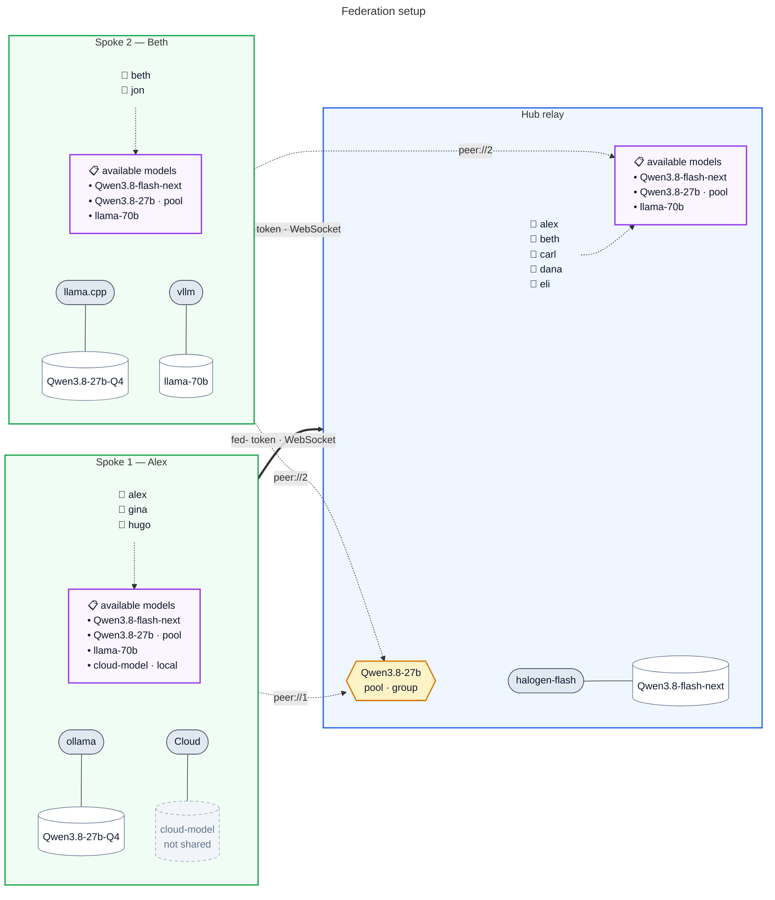

# llm-relay

OpenAI-compatible relay for local LLMs: per-key token metering, pricing and a cost dashboard (Go + SQLite, Docker).

Front a local LLM (any OpenAI-compatible server — llama.cpp, halogen, Ollama, …) and share it
with friends: each user logs into the dashboard, creates one API key per app, and every request
is metered (input / output / cache-read / cache-write tokens, per session, per client IP) and
priced. Admins manage backends, the model catalog and prices; users see their own usage and cost.
Several relays can also **federate** — a hub and its spokes pool model capacity across machines.

- **Relay API:** `:8080` (`/v1/*`, `sk-` keys) — what friends' apps point at
- **Dashboard + admin API:** `:8081` (JWT, embedded SPA) — the port to front with a reverse proxy
- **Repo:** https://github.com/Gizmozator/llm-relay

## Dashboard

After login every user lands on the **Dashboard**: a live server-wide view of
the last hour — a per-minute traffic graph with a metric dropdown (requests,
total / in new / cached / cache-write / out tokens), a per-model
**utilization graph** (busy time per minute; the axis scales to the model's
concurrency limit, so 4 parallel slots read as 0–400 %), how many streams are
decoding right now per model, and which catalog models are online (backend
health is re-probed at most once a minute). Cost stays off this view — it is
per-user and lives on the **Usage** pages. Admins additionally see **Active
connections** — who is on which model right now (user, key, endpoint, session,
IP, running time), **grouped one row per session**: parallel requests of the
same session show as `×N`, and finished requests stay listed for a minute as
"done 4s ago" — and a per-user **Last used** list, both as relative times
("1 min ago") refreshed with the same 5 s poll. The **Backends** page shows the
same live health verdict as its Status badge (re-probed at most once a minute,
the page re-polls every 10 s); the **Last probe** column keeps the result of
the last manual Probe.

The **Agent API** page explains how to point an AI agent at the relay: hand
your agent the public guide link (`{relay}/v1/agent-guide`), or wire the MCP
endpoint (`{relay}/mcp`, one `check_utilization` tool) so it can check
whether a model is `free` / `busy` / `draining` / `offline` before taking
delegated work. The guide also shows how to use the relay as an
OpenAI-compatible endpoint (`{relay}/v1`: list models, chat/text completions)
once a model is free. Agents authenticate with the same `sk-` keys from **My keys**.




Each backend has a **Draining** switch for graceful shutdown: flip it on
before powering the engine's server off and the relay refuses *new* sessions
on that backend (`503` + `Retry-After`), while conversations that are
currently running (active within 15 min) finish their remaining turns.
Agent endpoints report it as `status: "draining"`.

## Model groups

A **model group** is one public name (e.g. `qwen3-coder`) backed by several
model rows on different machines: users request the group name, the relay
picks a member per request. Admins manage groups on the **Models** page
(**Groups** panel): create a group, add members with weights, enable it.
Groups are born **disabled**, and a memberless group cannot be enabled. A
blank member weight seeds from that machine's last benchmark speed, so faster
machines take proportionally more sessions.

**Routing** is a weighted rendezvous hash of the session id: one conversation
is pinned to one member so each engine's prompt cache stays warm. Send a
stable `X-Session-Id` header to keep that affinity; different sessions spread
across members roughly proportional to their weights. Only *hard exclusions*
reroute — a disabled, draining, or unhealthy member is skipped. A **saturated
member does not reroute**: queueing at the engine beats cold caches for
everyone. If a member dies before its first byte, the request retries on the
next-ranked member; a stream that already started is never retried.

**Visibility** (the **Models** page's per-model switch) is *who can see a model
on this relay*: `public` lists it on `/v1/models` and the dashboard; `internal`
hides it from the catalog while leaving it directly requestable by name. Adding a
model to a group makes its members `internal` — the group name is what users
request; members stay directly requestable (pin/debug) and an admin can re-expose
one. Users see a group badge on the **Models** page, one pooled row per group on
the live dashboard, and usage billed under the requested group name. Sharing a
model with *other relays* is a separate switch — **Share**, see **Federation**.

The agent endpoints (`GET /v1/utilization`, MCP `check_utilization`) mirror
this split: non-admin keys get the advertised catalog — group rows (negative
`id`) plus public standalones; admin keys get the physical per-machine rows
(`docs/api-contract.md`).

## Federation

Two or more relays can pool their capacity: a **hub** accepts channels from
**spokes** — other relays that dial in with a server token and share selected
models. A spoke keeps running standalone; its opted-in models appear on the
hub as ordinary catalog rows (and are relayed onward to the other spokes), so
any user on any member can request them, with the same routing, affinity and
metering as local models. The spoke always dials out — the hub never needs to
reach into the spoke's network.



**Roles** are set on the admin **Federation** page: `standalone` (default, no
federation), `hub`, `spoke`. A spoke enters the hub URL + token there and sees
its live channel status; every user mints their own `fed-…` server token on
**My keys** and follows the **Connect server** guide (shown while the instance
is a hub). **Share** is a per-model switch on the admin **Models** page and is
about *who can use the model in the federation* — a different question from
**Visibility** (who can see it on *this* relay): `local` (stored `off`) shares
nothing, `all` shares it with the hub and every peer, `allowlist` shares it with
the selected peers only (on a spoke, effectively local — only `all` is pushed).
Nothing leaves the box until you opt a model in. Quickstart: hub → *My keys →
Server token* → spoke → *Admin → Federation → spoke + hub URL + token* → spoke
*Models* → set the models to share to `all`.

**Users see models, admins see the cluster**: a federated model behaves like
any other row (its health *is* the channel; groups may pool several peers'
copies), while the admin **Federation** page — role switch, the **Servers**
peer registry and the fairness ledger in one place — lists every peer with its
online state, version, shared models and the served-vs-consumed ledger, per
user and per server. Usage through a federated model is metered to the
consuming user and credited to the serving account: fairness bookkeeping,
not billing. The ledger tables carry the token usage itself — requests, new
input tokens, output tokens and cost per user and per server. The ledger counts
**cross-account** traffic whichever transport it took: using another account's
hosted model directly on the hub is credited just like traffic arriving through
a connected server (own-model and unowned-backend usage stays out). An account
with nothing attributable in the window has no row there by design, so the page
names those accounts ("nothing to attribute — their usage is on the Usage
page") instead of leaving a blank that reads as missing data. The window is a
rolling last-N-days range or a UTC calendar month (this/last month presets on
the page).

**Crediting the hub's own hardware**: a spoke's served capacity is credited to
its peer's owner user, but the hub's own backends had no such owner, so hub-local
serving left the per-user fairness table silent. An admin can now set an
**Owner** on any backend (the **Backends** page, or `owner_user_id` on the
backends API): usage that backend's own hardware serves to a peer is credited to
that user's *served* total — the hub-side mirror of a spoke's capacity crediting
its peer owner. A backend with no owner behaves exactly as before (hub-hardware
usage stays uncredited), and a spoke's own crediting is unchanged.

**Security**: server tokens (`fed-…`) authenticate only the federation
channel, never `/v1/*` (and API keys never the channel); they are hashed,
shown once, rotatable, and disabling a peer drops its live channel at once.
Spoke-local usernames never leave the spoke — the hub stamps its own identity
onto forwarded traffic and is the attribution authority for the ledger. The
channel is **TLS-only**: a spoke's hub URL must be `https://`, and against a
self-signed hub it pins the hub's certificate fingerprint (the **Hub pin**
field, from the hub's Settings → TLS page) so an on-path attacker cannot
steal the token. See **TLS for machine channels**.

## TLS for machine channels

Both machine-to-machine channels — spoke→hub federation connect and
connector→relay remote-backend connect — run over **TLS only**. There is no
cleartext opt-out: the connect endpoints answer `403 TLS required` to any
request that did not arrive over TLS. Two deployment shapes are supported:

- **Self-signed (the relay holds its own cert).** On the admin **Settings**
  page, the **TLS certificate** panel mints an ECDSA self-signed cert for the
  host names peers dial, and shows its **fingerprint** (`sha256:…`). The relay
  serves the relay mux over TLS on `TLS_PORT` (default `8443`) with that cert.
  Each peer pins the fingerprint: a spoke pastes it into the Federation page's
  **Hub pin** field; a connector sets `RELAY_PIN` in its `.env`. Regenerating
  replaces the key pair (every peer must re-pin); deleting stops all handshakes
  until a new cert exists.
- **TLS-terminating reverse proxy (the reference shape).** The proxy holds a
  real CA cert and forwards to the relay over plain HTTP. Then set
  `TLS_PORT=0` (no TLS listener) and **`TRUST_PROXY_HEADERS=true`** — with
  `TLS_PORT=0`, `X-Forwarded-Proto: https` from the proxy satisfies the gate.
  Peers dial the proxy's `https://` URL and verify normally against the system
  CA store: no pin, no generated cert. **Without `TRUST_PROXY_HEADERS` a
  proxied relay refuses its own spokes and connectors with 403** — set it.
  (`X-Forwarded-Proto` is honoured *only* with `TLS_PORT=0`: a relay that binds
  its own TLS listener has no proxy in front of the machine channels, so a
  forged header on the plain port must not bypass the gate — peers there dial
  the `wss` listener instead.)

The plain relay port (`PORT`) is untouched and keeps serving `/v1/*` over
whatever it always did; only the two connect endpoints are gated. The cert
lives in the database (single row), its private key plaintext-at-rest like every
other secret there — the file's permissions are the boundary.

## Abuse protection

Rate limiting and concurrency caps are a **server-wide property**: every
listener answers with bounded work per client in **every mode** (standalone,
hub, spoke — all serve the relay and admin muxes). All limiters are in-memory
(single-instance app), size-capped with TTL/LRU eviction so the limiter
itself can never become the DoS, and every denial carries a truthful
`Retry-After`. **Setting a tier's rate or burst to `0` turns that tier off**
(the dev/LAN escape); defaults are sized so legitimate traffic never sees a
429/503.

| tier | keyed on | protects | knobs (default) |
|---|---|---|---|
| pre-auth endpoints | source IP | `POST /api/auth/login` | `RATELIMIT_LOGIN_RATE`/`_BURST` (`0.2`/`10`) |
| login failure backoff | source IP **+ username** | per-account password spraying across many source IPs | `RATELIMIT_LOGIN_LOCK_AFTER`/`_SECONDS` (`5`/`30`) |
| machine endpoints | source IP | `/federation/v1/*`, `/remote/v1/connect` (each bad token costs a hash + DB lookup) | `RATELIMIT_CONNECT_RATE`/`_BURST` (`0.2`/`10`) |
| `/v1` per client | source IP | the public relay surface, pre-auth (bad-key floods) | `RATELIMIT_V1_IP_RATE`/`_BURST` (`100`/`200`) |
| `/v1` per key | resolved API key | authenticated abuse, applied after auth before proxy work | `RATELIMIT_V1_KEY_RATE`/`_BURST` (`50`/`100`) |
| remote edge channel | remote-backend id | client requests forwarded over a backend box's channel (tier 5, ticket #17) — keyed on the **backend**, not the socket IP: one box shares one source for all its users | `RATELIMIT_REMOTE_CHANNEL_RATE`/`_BURST` (`100`/`200`) |
| admin API | dashboard user | runaway scripts / stolen sessions on `/api/*` | `RATELIMIT_ADMIN_RATE`/`_BURST` (`100`/`200`) |
| global shed | server-wide | total in-flight requests → `503` at saturation | `RATELIMIT_GLOBAL_MAX_INFLIGHT` (`1024`) |

Behaviour notes:

- **Login**: a successful login resets the per-IP bucket; five consecutive
  failures for one (IP, username) pair lock that pair out for 30 s,
  doubling per additional failure up to 15 min — the correct password is
  refused with 429 until the window passes, then works again.
- **Connect endpoints**: a valid token resets the bucket, so a legitimately
  reconnecting spoke/connector never drains its own credits; only failing
  traffic does.
- **Streaming is never broken**: there is deliberately no blanket
  `WriteTimeout`/`ReadTimeout` on the HTTP servers — long SSE streams stay
  bounded by per-handler deadlines and idle timeouts, not by a wall clock on
  the socket.
- **Tunnel channels (reserved seam)**: per-backend/per-peer channel admission
  (tier 5 of the plan) is the future home of the federation channel's
  bespoke `fed.MaxInflight` cap; it moves over when the channel rework
  (#17) lands. Per-socket IP is the wrong key there — one spoke box is one
  shared source for all its channels.

**Source IP and `TRUST_PROXY_HEADERS`**: every per-IP tier keys on the peer
address, and consults `X-Forwarded-For` (rightmost entry — the one appended
by your own proxy) **only when `TRUST_PROXY_HEADERS=true`**. That flag is
not optional behind a reverse proxy: without it every client behind the
proxy shares the proxy's IP and one bucket, so a single abuser locks
everyone out of login, `/v1` and the connect endpoints. Conversely, turning
it on while clients can reach the relay directly lets them mint one bucket
per forged header — the flag means *"every request arrives through my
proxy"*.

## Remote backends

A **remote backend** is an engine on another machine — typically behind NAT —
that dials **into** this relay over a WebSocket and then behaves like any
other backend on the Backends page: probeable, group-eligible, routable.
No inbound ports on the remote box, and it works on any relay role
(standalone, hub or spoke).

Flow: an admin clicks **+ Remote backend** on the Backends page and gets a
one-time connect token (`rb-…`). The remote box runs the same `llm-relay`
binary in connector mode (`HEADLESS=true`) and dials
`<RELAY_URL>/remote/v1/connect`. From then on every request the relay routes
to that backend — including **Probe / Sync models** — travels over the
connection. Health = the live connection: when it drops the backend reads
offline and traffic fails over like a refused socket; the connector redials
on its own.

| var | default | meaning |
|---|---|---|
| `HEADLESS` | `false` | connector mode: binds nothing, owns no state; when true the three vars below are **required** (missing = boot error) |
| `RELAY_URL` | — **required** | the relay to dial in to (server root); **must be `https://`** — remote connections require TLS |
| `RELAY_TOKEN` | — **required** | the `rb-…` connect token minted on the Backends page |
| `RELAY_PIN` | — | the relay cert fingerprint (`sha256:…`) to pin when the relay uses a self-signed cert; empty verifies against the system CA store (a TLS-terminating proxy with a real cert) |
| `ENGINE_URL` | — **required** | the local OpenAI-compatible engine to expose |
| `ENGINE_TOKEN` | — | bearer token for the engine (optional) |
| `PROXY_LISTEN` | — (off) | **edge proxy mode**: bind a local `/v1` listener on this box that forwards its clients' traffic over the channel to the relay (see below). Empty = the connector binds nothing |

One connector = one engine; run one connector per engine. The connector
serves only `/v1/*` and `/health` to the relay — the tunnel never becomes a
proxy into the box's network. A connector box needs no `JWT_SECRET` (it
serves no dashboard) and binds no ports. Rotating the token on the Backends
page drops the live connection immediately; so do disable and delete.

### Edge proxy mode (`PROXY_LISTEN`)

A box on a remote LAN can also be that LAN's **gateway to the relay**: with
`PROXY_LISTEN` set (e.g. `8080`), the connector binds a local `/v1` listener
and forwards whatever its clients send over the existing channel. The relay
runs each request through its full pipeline — the client's `sk-` key is
authenticated by the relay itself, usage lands on the real key and user,
routing and groups work as always. Clients point their OpenAI base URL at
the box instead of the relay; no keys live on the box.

> **⚠ The default bind is `127.0.0.1`.** A bare port or `:port` binds
> loopback only. Only an explicit host (`0.0.0.0:8080`, a LAN address)
> opens the listener to other machines — **rebinding public is on you**:
> the relay rate-limits each channel per-backend, but it cannot defend a
> connector box exposed to the open internet. Keep the listener on the LAN.

Guards on the path: a per-channel rate limit (tier 5, keyed on the backend,
`RATELIMIT_REMOTE_CHANNEL_*`), a local concurrency cap with immediate `503`
shed (never a queue), a body-size cap, and a loop guard — traffic arriving
over a backend's channel is never routed back to that same backend.

Ready-made copies live in `deploy/remote-backend/`. Bring-up steps, how to
verify on the relay and common failures: `docs/workflows/remote-backend.md`.

## Supported upstream dialects

| Route | Dialect | Metered |
|---|---|---|
| `POST /v1/chat/completions` | OpenAI chat (streaming + tools) | yes |
| `POST /v1/completions` | OpenAI text | yes |
| `POST /v1/responses` | OpenAI Responses (Codex CLI) | yes |
| `POST /v1/messages` | Anthropic Messages (Claude Code) | yes |
| `POST /v1/messages/count_tokens` | Anthropic | pass-through |
| `POST /v1/embeddings` | OpenAI embeddings | yes |
| `GET /v1/models` | catalog listing | — |

Usage is taken from upstream `usage` reports (streaming included); a chars/4 heuristic is the
fallback and such rows are flagged `usage_estimated`. Sessions come from the `X-Session-Id`
header or a derived conversation hash. Streams carry an SSE comment line (`: keepalive`)
roughly every 20 s of upstream silence so edge proxies (Cloudflare's ~100 s idle limit)
don't cut long prefills; compliant SSE parsers ignore comments.

## Quickstart

```bash
cp .env.example .env      # set JWT_SECRET (+ optional bootstrap admin)
make docker-up            # build image + start: relay :8080, dashboard :8081
```

Open `http://localhost:8081`, log in, then: **Backends → add** the LLM server base URL
(e.g. `http://your-llm-host:8731`) → **Sync** → pick discovered models → set prices →
**My keys → create key** → point any OpenAI-compatible client at `http://localhost:8080/v1`
with the key as bearer token.

For self-hosted engines, the admin Models page has a **Benchmark** button per model:
it measures generation speed (TG — decode of a natural prose prompt) and prompt-
processing speed (PP — a ~10k-token randomized prompt, time to first token) against
the upstream. A **remote backend** is benchmarked through its live channel, exactly
like the probe — the tunnel carries the timed stream, so the numbers measure the
engine, not a refused `remote://` dial. The **Calc prices** calculator prefills both speeds from the last run;
enter the machine's power draw for generation and prompt processing plus the
electricity price, and it derives cost-recovery prices (rounded up to 1 cent per 1M
tokens, editable before applying).

For local dev without Docker: `make web && make run`.

## Common tasks

| task | command |
|---|---|
| list all targets | `make` |
| build binary / web dashboard | `make build` / `make web` |
| full check (fmt + vet + tests) | `make ci` |
| run locally | `make run` (relay `:PORT`, dashboard `:ADMIN_PORT`) |
| build container | `make docker-build` |
| start / stop local stack | `make docker-up` / `make docker-down` |
| publish container image | `make docker-release VERSION=0.1.1` |
| federation e2e (manual, localhost 18xxx) | `scripts/e2e-federation.sh` |

## Configuration

Environment (or `.env`, see `.env.example`):

| var | default | meaning |
|---|---|---|
| `PORT` / `LISTEN_ADDR` | `8080` | relay API port (host mapping) |
| `ADMIN_PORT` / `ADMIN_ADDR` | `8081` | dashboard + `/api/*` port |
| `DB_PATH` | `/data/llm-relay.db` | SQLite file (parent dir auto-created) |
| `JWT_SECRET` | — **required** | dashboard JWT signing key (≥32 chars, HS256 floor; `openssl rand -hex 32`); **not needed when `HEADLESS=true`** — a connector has no dashboard to sign into |
| `ADMIN_USERNAME` / `ADMIN_PASSWORD` | — | bootstrap admin, first run on empty DB only |
| `TRUST_PROXY_HEADERS` | `false` | trust `X-Forwarded-For` on both listeners (set behind a reverse proxy): the proxy's metering and **every per-IP rate limit** key on the real client (rightmost XFF entry); without it all proxied clients share the proxy's bucket. **Also required for a TLS-terminating proxy**: with it on **and `TLS_PORT=0`**, `X-Forwarded-Proto: https` satisfies the machine-channel TLS gate (see **TLS for machine channels**) |
| `TLS_PORT` / `TLS_ADDR` | `8443` | TLS listener for the machine channels (federation + remote-backend connect), serving the same relay mux with the dashboard-generated cert. `0` disables it (the TLS-terminating-proxy deployment, where the proxy holds the real cert) |
| `RATELIMIT_LOGIN_RATE` / `_BURST` | `0.2` / `10` | login per-source-IP token bucket (sustained req/s / burst). `0` on either disables the tier |
| `RATELIMIT_LOGIN_LOCK_AFTER` / `_SECONDS` | `5` / `30` | consecutive failures per (IP, username) before lockout / initial lockout seconds (doubles per extra failure, capped 15 min). `0` disables the lockout |
| `RATELIMIT_CONNECT_RATE` / `_BURST` | `0.2` / `10` | per-source-IP bucket on `/federation/v1/*` + `/remote/v1/connect`. `0` disables |
| `RATELIMIT_V1_IP_RATE` / `_BURST` | `100` / `200` | per-source-IP bucket on the public `/v1` surface (pre-auth). `0` disables |
| `RATELIMIT_V1_KEY_RATE` / `_BURST` | `50` / `100` | per-API-key bucket on authenticated `/v1` traffic. `0` disables |
| `RATELIMIT_REMOTE_CHANNEL_RATE` / `_BURST` | `100` / `200` | per-remote-backend bucket on edge-proxy traffic forwarded over a backend's channel (tier 5). `0` disables |
| `RATELIMIT_ADMIN_RATE` / `_BURST` | `100` / `200` | per-user bucket on the authenticated dashboard API. `0` disables |
| `RATELIMIT_GLOBAL_MAX_INFLIGHT` | `1024` | server-wide in-flight cap; at saturation new requests get 503 + `Retry-After`. `0` disables the shed |
| `PUBLIC_RELAY_URL` / `PUBLIC_DASHBOARD_URL` | — | URLs shown in the dashboard copy buttons and interpolated into the agent guide; **include the scheme**, and a hostname or a plain IP:port both work (LAN hosting: `http://192.0.2.10:8080`); relay is the **root** (no `/v1` — the dashboard appends `/v1` for the OpenAI base) |
| `HEADLESS` (+ `RELAY_URL`/`RELAY_TOKEN`/`ENGINE_URL`/`ENGINE_TOKEN`, opt `PROXY_LISTEN`) | `false` | remote-backend connector: dial in to a relay and expose a local engine — see **Remote backends** |
| `TZ` | `Europe/Helsinki` | timezone |

## Deployment

`deploy/` ships a sample container-compose stack. Point it at your own registry and
data directory, set `JWT_SECRET` (+ optional bootstrap admin) in the stack `.env`,
and publish a new image version with `make docker-release VERSION=x.y.z`. That
target cross-builds a multi-arch manifest (`linux/amd64` + `linux/arm64` by
default, override with `PLATFORMS=…`) and pushes it in one step via BuildKit —
the Go binary is a static cross-compile, so no emulation is needed. The first
run auto-creates a `docker-container` buildx builder (`BUILDER=…` to name it).
`make docker-build` remains the fast single-arch local build for development.

Every binary carries its build version: `make build` stamps it with
`git describe --tags --always --dirty` (`-ldflags "-X main.version=…"`), and
`make docker-build` / `make docker-release` pass the same stamp (or the
release `VERSION=…`) into the image build via `--build-arg VERSION=…` — the
`.git` dir is not in the Docker build context, so the version cannot be
derived inside the image. An unstamped build falls back to the Go build-info
module version, then to `dev`. The relay reports this version in the
federation handshake (hello/hello_ack), so the admin Federation page's peer
**Version** column and the spoke's **Hub version** card show the version each
side actually runs.

Every non-200 request is mirrored to stdout: a one-line summary (`relay: 499
…` with user, key, model, IP, duration and token counts) and, for streams, a
diagnostic of what the relay saw before the connection died — time to the
upstream's first line, lines/bytes forwarded, keepalives sent, context error.
That distinguishes "the client gave up during a long prefill" from "the
upstream broke mid-generation", and is the line to cross-reference against a
reverse proxy's access log when a 499 appears (the relay cannot see *which*
hop upstream hung up — an app, a tunnel and a proxy all look the same).

## Layout

```
llm-relay
├── cmd/llm-relay/         main: config, wiring, dual-port servers, embedded SPA
├── internal/config        env parsing
├── internal/db            SQLite open + embedded migrations
├── internal/auth          bcrypt, JWT, API key generation/hashing
├── internal/store         all SQL: CRUD + usage aggregation
├── internal/pricing       cost snapshots (integer micro-units)
├── internal/usage         buffered usage recorder
├── internal/proxy         dialect forwarder, SSE scanning, backend discovery
├── internal/fed           federation: hub/spoke channel, dialer, peer registry
├── internal/remote        remote backends: server registry + headless connector
├── internal/tlscert       self-signed cert mint + SHA-256 pin dialing (machine channels)
├── internal/api           dashboard JSON API (user + admin)
├── web/                   Vite + React + Chart.js dashboard (embedded via go:embed)
├── scripts/               manual tools: federation e2e (two relays + mock engines)
├── deploy/                sample container-compose stacks (incl. remote-backend/)
├── docs/
│   ├── api-contract.md    authoritative HTTP API contract
│   ├── screenshots/       dashboard screenshots (shown in README)
│   ├── workflows/         how we work: review, bug loop, feature loop, conventions
│   └── plans/             implementation plans (current + archived)
├── Dockerfile             node → go → scratch multi-stage
└── docker-compose.yml     local stack
```

## Documentation

Start at `AGENTS.md` for working rules, `docs/api-contract.md` for the HTTP surface,
`docs/workflows/README.md` for the runbooks, and `docs/plans/` for what is being built now.
